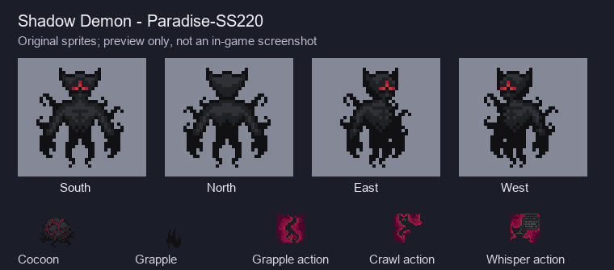

# Тенедемон

Порт Shadow Demon из Paradise-SS220 в BandaStation. Источник,
авторы ресурсов и лицензии перечислены в [ATTRIBUTION.md](ATTRIBUTION.md).



## Как запустить

- В админ-панели антагонистов добавьте роль «Тенедемон». Создаётся новое тело,
  существующий mind переносится в него; прежнее тело сохраняется.
- Принудительно запустите событие `Shadow Demon`: оно опросит призраков и найдёт
  безопасное тёмное место в технических помещениях. При отсутствии кандидата
  или места событие завершается без появления демона.
- В книге волшебника: «Поддержка» → `Bottle of Shadows`, 1 очко, максимум 3.
  Флакон нужно активировать на станции. Призванный демон начинает в бесплотной
  форме и получает цель убить призывателя.
- Для прямого административного создания: `/mob/living/basic/demon/shadow`.

Случайное событие автоматически не выбирается (`max_occurrences = 0`).
Это позволяет включать нового антагониста при ручном запуске и через штатный
магический флакон, не меняя существующую частоту событий на сервере.

## Перенесённые механики

| Механика | Поведение |
| --- | --- |
| Тело | 200 здоровья; удар 30; урон объектам 50; интервал атаки 2 секунды; не загорается |
| Темнота | При освещённости ≤ 0,2 восстанавливает 10 здоровья/с; полупрозрачность и ускорение |
| Свет | При освещённости > 0,2 получает 20 урона/с; в бесплотной форме — 10/с |
| Атмосфера | При недостатке кислорода — 9 урона/с, что оставляет 1 здоровья/с регенерации в темноте |
| Shadow Grapple | Перезарядка 10 с; жертве 40 brute и обездвиживание 2 с, затем притяжение; попадание в объект притягивает демона |
| Гашение | Захват гасит источники света в радиусе 2; лампы подавляются на 5 минут; фальшфейеры и slime-light выдерживают обычное касание, но не захват |
| Shadow Crawl | Мгновенный уход в тень; проход сквозь стены; возвращение за 2 с к тёмному тайлу рядом; перезарядка 1 с после возвращения |
| Демонический шёпот | Сообщение прямо в разум видимой живой жертвы; работает и в бесплотной форме |
| Кокон | Атака мёртвого человека запускает плетение на 4 с; 100 прочности, тьма радиусом 6, гашение рядом; Alt+ЛКМ переключает звуки-приманки |
| Сердце тьмы | Выпадает после смерти; поедание заменяет сердце и даёт Shadow Grapple; извлечение убирает только способность этого сердца |

Интенсивность периодических эффектов пересчитана с двухсекундного тика
Paradise на `seconds_per_tick` Banda. Скорость использует штатные модификаторы
движения и серверный темп Banda. Blood Crawl и Nightmare не изменены.
Для местных MOD-фонарей, прикреплённых фонариков и pAI использованы их штатные API;
MOD-модуль тьмы сохраняет работу. Сохранены местные ограничения `NOJAUNT`/антителепорта.

## Проверка

Сначала подготовьте штатную сборку через `BUILD.cmd`: нужны генерируемые ресурсы
и версии библиотек из `dependencies.sh`, включая rust-g 7.0.0. Затем из корня
репозитория в PowerShell:

```powershell
.\tools\shadow_demon\test-shadow-demon.ps1
```

Скрипт компилирует тестовую обёртку, запускает изолированный сервер и сохраняет
результаты, полный runtime-лог и отметку чистого завершения в `tmp/shadow-demon-*`.
Тесты подключены до удаления макросов assertions в штатном `_unit_tests.dm`.
Тестовая обёртка не входит в исходники для коммита.

Для проверки ресурсов нужен каталог исходного донора с прежними путями:

```text
python tools/shadow_demon/extract_assets.py PATH_TO_DONOR --check
```

Перед игровым включением проверить с клиентами:

1. Создать демона в тёмных техах, выйти на свет с ручным/потолочным фонарём,
   проверить видимость порога света и ожоги в обеих формах.
2. Захватить живую цель, стену и напольную лампу; проверить полёт руки, луч,
   притяжение и запрет ухода в тень до завершения броска. Сменить питание APC.
3. Пройти сквозь стену, материализоваться, прервать материализацию движением;
   проверить, что свет не выбрасывает из формы, но продолжает наносить урон.
4. Завернуть труп, прервать плетение перемещением/оживлением жертвы, включить
   приманку и разрушить кокон. Положить рядом незажжённый фальшфейер: он должен
   сохранить топливо. Проверить сварку и уже горящий фальшфейер.
5. Призвать демона флаконом с другим клиентом-призраком; отменить опрос,
   передать флакон во время опроса, проверить отказ повторного использования
   и цель на призывателя. Проверить посадку в роль через админ-панель и событие.

Клиентская проверка спрайтов, звуков и многопользовательский раунд не заменяются
DM-тестами. Производительность при большом количестве коконов отдельно не профилировалась.
