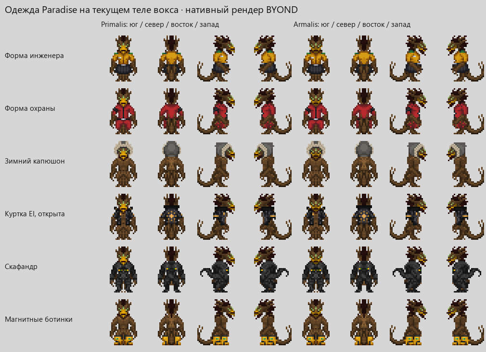

# Воксы для BandaStation

[Результаты проверок](VOX_VALIDATION.md) · [Чего не хватает в одежде](VOX_CLOTHING_GAPS.md)

Источник переноса — [BandaStation PR #2682](https://github.com/ss220club/BandaStation/pull/2682),
зафиксированный на `319e91d353a34b90263bda08b5409ca3d85e3dbd`.
Независимая база BandaStation — `35e3f4bafc3e9e311e5b00f37616b24a9d0e7a0e`.
Порт не требует изменений КПБ и включает общие исправления Windows runtime и запуска.

Paradise-SS220 использован для сверки азотного дыхания, мозгового стека
и происхождения звуков; это адаптация указанного PR к TG/Banda API.
Код всего вида Paradise поверх TG не накладывается.

## Что перенесено

- Раундстартовая раса с настройками клюва, оперения, лицевых перьев,
  окраски конечностей и рисунка груди.
- Азотные лёгкие с кислородной токсичностью, кибернетический мозговой стек,
  видовые органы, кровь, хвост и когтистые конечности.
- Азотные баллоны и маска; активные internals при выдаче профессии
  и подходящая запасная коробка.
- Питание платами, фонарями, ПДА, GPS, радио и электроникой.
- Вокс-пиджин, имена, звуки эмоций и мутационный токсин.
- Одежда, EVA/MOD, предметные спрайты и русские названия.

Доступность совпадает с исходным PR: `ROUNDSTART_RACES vox` в
`config/bandastation/bandastation_config.txt`. Если сервер хранит собственную
копию конфигурации, эту строку нужно добавить в неё при установке.

## Исправления относительно источника

Сохранение ДНК использует отдельные корректные блоки узора груди и пяти
цветов. Выбран действительный дефолт оперения. Превью не создаёт реальное
оборудование жизнеобеспечения.

Поедание работает через принадлежащий устройству компонент и существующий
сигнал атаки. Проверки вида, владения предметом, состояния и расстояния
выполняются повторно после задержек и обработчиков событий. Удаление
устройства удаляет временную еду. Повторные клики используют тот же компонент.
Прочность обычной электроники и поведение обычных атак сохраняются.

Подключены спрайты униформы, обуви, сумок и MOD. Добавлены GAGS-конфигурации,
чтобы цветная одежда сохраняла выбранный цвет. Исправлены дубли масок,
отсутствующие состояния ног при сжатии обувью и выбор шлемных спрайтов.
Шапки под раскрытым MOD используют вид пересаженной головы.

## Исправления после игрового теста

Воксы не разлагаются после смерти: тело не получает активное гниение,
а установленные органы не повреждаются от посмертного распада. Защита
принадлежит расе; при превращении мёртвого вокса в человека обычное
разложение снова работает. Это не даёт иммунитет к заболеваниям или
повреждениям органов от других причин. Снятые органы портятся обычным образом.

Добавлены две эмоции с русскими названиями в панели и командами в чате:

- `*quill` — шелестеть перьями; исходные сообщение и звук воксов Paradise.
- `*click` — щёлкать клювом; звук `kidanclack2.ogg` из Paradise адаптирован
  для клюва вокса. В исходнике это эмоция киданов, поэтому её расовые
  способности не переносятся.

Обе эмоции используют штатное воспроизведение звука и ограничения по
состоянию персонажа. Их нельзя выполнять без соответствующего органа.
Немые воксы могут шелестеть и щёлкать: эти звуки не требуют голоса или языка.

## Одежда Paradise

Перенесено 180 состояний одежды из `ss220club/Paradise-SS220`,
ревизия `0fffca1f1f29a63aff49d9b56524813eedf82c6d`:
88 состояний униформы, 42 головных убора, 26 верхней одежды,
11 обуви, пять перчаток, четыре рюкзака и четыре украшения на шею.
Это состояния изображений, включая переключаемые варианты, а не новые предметы.

Те же существующие вещи используют общий `get_species_worn_icon()`:
явно проверенная замена незавершённого состояния, имеющийся спрайт Nova,
дополнительный спрайт Paradise, затем обычный worn-спрайт.
Предметы не дублируются; характеристики и доступность сохраняются.
Такой выбор изображения на существующем предмете соответствует подходу
[NovaSector](https://github.com/NovaSector/NovaSector/blob/3b84ce0ba3e02ed031d714d642d84ddaa6f7e9b9/modular_nova/modules/customization/modules/mob/living/carbon/human/custom_bodytype.dm#L62-L86).
Готовые цветные изображения Paradise не подменяют GAGS-конфигурации;
64-пиксельная обувь сохраняет свой размер и привязку.

Сохранены четыре направления, исходные цвета и параметры анимации.
166 состояний перенесены без изменения пикселей; 14 зимних капюшонов получили
по 42 дополнительных пикселя из собственной ткани и окантовки, чтобы закрыть
выступы текущей головы. Маски свечения синей и обычной тыквы получены из
авторских пикселей глаз и рта; кожура не светится.
Тело, клювы и перья остаются текущими. Перья теперь учитывают обычные маски
волос капюшонов и шапок; снятие вещи восстанавливает их изображение.
Четыре рыцарских костюма отклонены из-за второго нарисованного хвоста;
маски Paradise не подключены из-за отличающейся посадки на клюве.
Оставшиеся пробелы и причины перечислены в [VOX_CLOTHING_GAPS.md](VOX_CLOTHING_GAPS.md).



При холодном запуске найден и исправлен существовавший до переноса выход
генератора рек за границу карты, приводивший к бесконечному циклу.
Точная диагностика и проверка — в `tools/vox/RIVER_REGRESSION.md`.

## Как проверить

```powershell
tools/build/build.bat
tools/vox/test-vox.ps1 -IncludeHumanoidScreenshots -TimeoutSeconds 600
python tools/vox/check_assets.py
python tools/vox/check_paradise_assets.py --source <каталог исходных файлов Paradise>
```

Набор запускает проверки воксов и общие проверки
видов, органов, одежды, предметных спрайтов и языков. Он требует результаты
каждого теста, завершение сервера, отсутствие runtime-ошибок и сравнение PNG.
Артефакты отдельного запуска остаются в `tmp/vox-test-*`.

Адаптация изображений воспроизводится командой
`python tools/vox/adapt_assets.py --source <каталог исходных файлов PR>`.
Внутри исходного каталога должна сохраняться структура путей репозитория.
Хэши и источники — в `tools/vox/source-assets.json`, атрибуция изображений —
в `icons/bandastation/mob/species/vox/attributions.txt`, звуков —
в `modular_bandastation/emote_panel/audio/vox/attributions.txt`.
Контрольные суммы пяти звуков Paradise закреплены в соседнем `source-assets.json`
и проверяются той же командой `tools/vox/check_assets.py`.

Для одежды Paradise используйте
`python tools/vox/adapt_paradise_assets.py --source <каталог исходных файлов Paradise>`.
Ключ `--check` проверяет побайтовую воспроизводимость без изменения файлов.
Нужны только файлы из `tools/vox/paradise-source-assets.json`, с исходными путями.
Точное сопоставление состояний и существующие предметы для тестов находятся
в `tools/vox/paradise-clothing-map.json`; атрибуция CC BY-SA 3.0 —
в `icons/bandastation/mob/species/vox/paradise/attributions.txt`.
Нативная матрица изображений охватывает каждое сопоставление с обоими клювами
и четырьмя направлениями, а также настоящие переключения кепки и магнитных ботинок.

## Проверка в клиенте

На локальном сервере выбрать вокса, изменить все цвета и узор, сохранить
персонажа и снова открыть настройки. Зайти ассистентом, инженером, клоуном
или мимом; проверить маску, азотный баллон и запасную коробку. Снять маску,
получить кислородное отравление и восстановить подачу азота. Поесть электронику,
прервать действие выбрасыванием предмета, проверить обычную атаку в боевом режиме.
Проверить шлем, противогаз, EVA и раскрытый/закрытый MOD во всех направлениях.
В панели эмоций найти «Шелестеть перьями» и «Щёлкать клювом», проверить
звук для соседнего игрока и команды `*quill` / `*click`, в том числе с обычной
дыхательной маской вокса; между эмоциями выдерживать штатные три секунды.
Мёртвые и бессознательные персонажи их не выполняют.
Для проверки распада оставить тёплые тела вокса и человека рядом более
16 минут: органы вокса не должны получать повреждения от гниения,
а человек остаётся обычным органическим контрольным телом.

Автоматические сценарии и структурная проверка DMI не гарантируют отсутствие
всех возможных дефектов и не заменяют многопользовательский тестовый раунд.

Исправлен сбой Windows при выгрузке rust-g: поставляемая `rust_g.dll`
закрепляет собственный модуль до завершения процесса, чтобы живые native-потоки
не обращались к выгруженному коду. Исходный патч, рецепт сборки и результаты:
[Windows rust-g](../../tools/rustg/VALIDATION.md).
После обновления DLL нужен полный перезапуск DreamDaemon; перезапуска раунда
для замены уже загруженной библиотеки недостаточно.

При разделении портов также добавлены гарантированные пакеты крови воксов в
медицинский груз и морозильник. Незаконченный укус электроники сохраняет её
исходный флаг debris. Для двух инженерных капюшонов, куртки СБ и сигнального конуса добавлены
четыре воспроизводимые отражающие маски, обрезанные по альфа-силуэту одежды;
локальный набор включает CI-проверку `invalid_emissives`.

Автономный порт включает нейтральные проверки доступности еды до укуса и
после callbacks, а также безопасный EMP извлечённого кибернетического мозга.
Они используют базовые API BandaStation и не требуют кода или органов КПБ.
